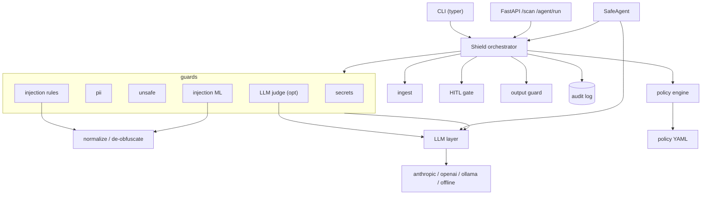
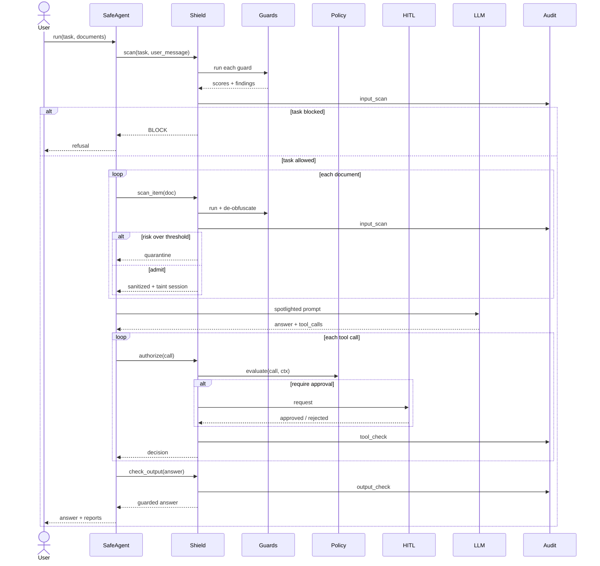
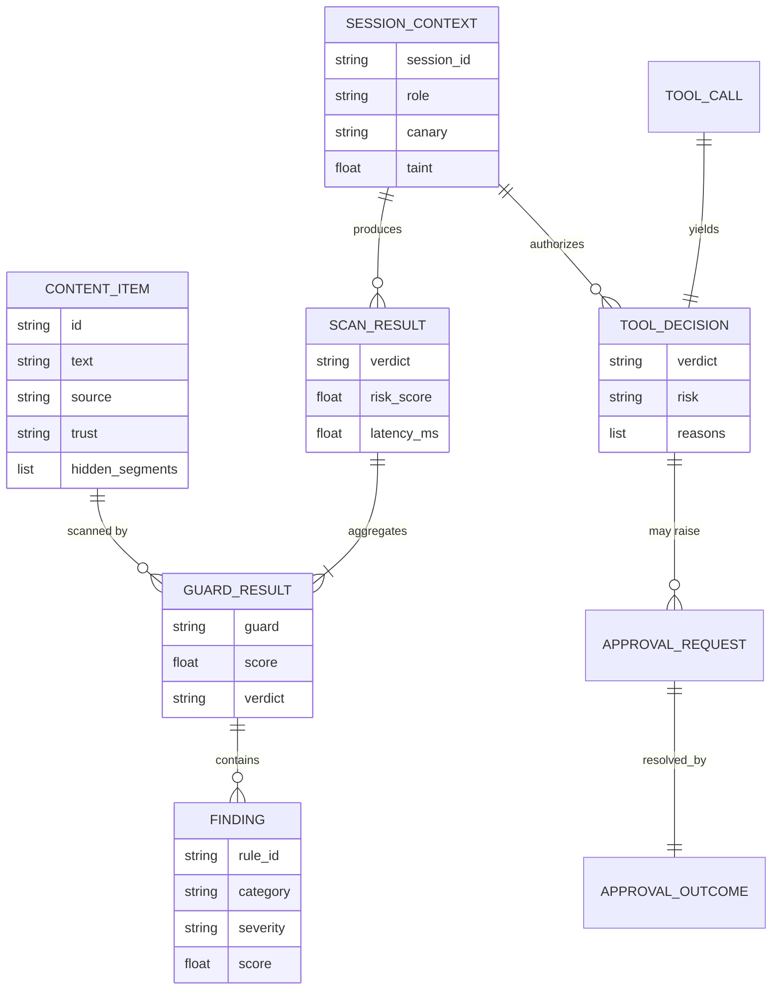
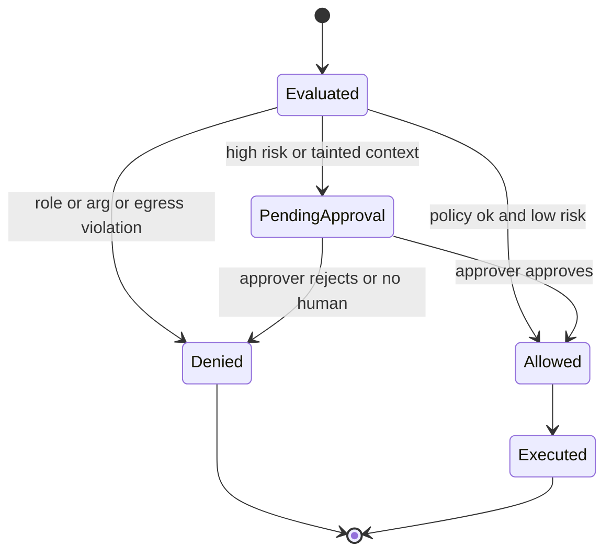

# AgentShield — Architecture

## Overview

AgentShield is a guardrail layer that mediates every interaction between an LLM agent and untrusted
content or privileged tools. It is built from small, single-responsibility **guards** combined under
one **orchestrator** (`Shield`). The design goals, in order: (1) fail safe — a miss or a crash in any
one layer must not open the agent; (2) explainability — every decision carries machine-readable
reasons and a score; (3) offline reproducibility — nothing runnable requires a network or API key.

The core insight the architecture encodes: an agent's context is a mix of content at different
**trust levels**, and injection is what happens when untrusted content is treated as instructions.
So trust/provenance is a first-class property that flows from ingestion through scoring, spotlighting
and the tool policy.

## Components

| Component | Responsibility |
| --- | --- |
| `models.py` | Pydantic v2 domain model: `ContentItem` (text + source + trust + hidden segments), `Finding`, `GuardResult`, `ScanResult`, `ToolCall`/`ToolDecision`, `SessionContext` (carries canary + taint). |
| `normalize.py` | Produce the readings of a text a capable model could recover: NFKC, zero-width removal, homoglyph folding, Unicode-tag (ASCII smuggling) extraction, spaced-letters, leetspeak, base64, hex, ROT13. |
| `ingest.py` | Loaders per source. The HTML loader separates visible text from hidden text (CSS `display:none`, white-on-white, zero-size fonts, `aria-hidden`, comments, long `alt`/`title`). |
| `guards/rules.py` | 30+ weighted regex rules across override / jailbreak / prompt-leak / exfiltration / tool-abuse, run over every de-obfuscated variant and hidden segments; combined with noisy-OR. |
| `guards/classifier.py` | TF-IDF (word 1–2 grams + char 3–5 grams) → `LogisticRegression`, trained in-process from `data/injection_train.jsonl`. |
| `guards/llm_judge.py` | Optional LLM-as-judge over spotlighted content; parse failures fail closed. |
| `guards/content.py` | PII detect/redact (Luhn, mod-97 IBAN), secret/key detection, unsafe-category lexicon. |
| `guards/output.py` | Output-side: canary + n-gram prompt-leak detection, egress-link stripping, output PII redaction. |
| `spotlight.py` | Wrap untrusted content in unpredictable delimiters and datamark/encode it. |
| `policy.py` + `policies/default.yaml` | Role→tool allowlist, per-argument constraints, egress domain allowlist, taint policy. |
| `hitl.py` | Approval gate with pluggable approvers (deny-all default, callback, console). |
| `audit.py` | Append-only hash-chained JSONL with `verify_chain`. |
| `shield.py` | Orchestrates guards → scoring → spotlight/taint → policy → HITL → output guard → audit. Exposes decorators. |
| `agent.py` | `SafeAgent`: a document-summarising, tool-using agent that only touches the world through the Shield (or, with `shield=None`, the unprotected baseline). |

### Component diagram

## Request lifecycle

The main path is `SafeAgent.run(task, documents)`. Input is scanned, documents are quarantined or
admitted (and spotlighted), the model plans an answer plus tool calls, each call is authorised, and
the output is guarded — with an audit record at every step.

## Data model

A scan flows from a provenance-tagged `ContentItem` to a `ScanResult` aggregating per-guard results;
tool calls produce `ToolDecision`s; approvals produce `ApprovalRequest`/`ApprovalOutcome`.

### Verdict lattice

Verdicts form an ordered lattice; combining results takes the max rank, so any guard can only make a
decision stricter, never looser:

`ALLOW (0) < REDACT (1) < REVIEW (2) < BLOCK (3)`

Injection risk is compared to per-trust thresholds; content guards (PII/secrets/unsafe) can raise the
verdict independently (e.g. a secret forces REDACT, a weapons recipe forces BLOCK).

## Approval state machine

High-risk and taint-escalated tool calls transition through the HITL gate:

## Design decisions (ADR style)

### ADR-1: Defense in depth of independent guards
- **Context:** No single injection detector is robust; attackers adapt to whatever one model learns.
- **Decision:** Compose several weak, independent, explainable guards; combine injection scores with
  noisy-OR and take the strictest content verdict; make each guard a `Guard` protocol so it is
  pluggable.
- **Consequences:** Higher latency than one model, and some double-reporting, but no single bypass
  target and fully explainable decisions. A guard that raises is treated as a failure and fails
  closed for untrusted sources.

### ADR-2: Train the classifier in-process instead of shipping a pickle
- **Context:** The repo must be reviewable and safe to run; pickles execute arbitrary code on load.
- **Decision:** Commit a human-readable JSONL dataset and train the TF-IDF+LR pipeline on first use
  (<1 s), cached with `lru_cache`.
- **Consequences:** Small cold-start; fully transparent and reproducible; no binary artifacts in git.

### ADR-3: Trust levels drive thresholds; taint drives tool gating
- **Context:** The same words are benign from the user and hostile from a scraped web page.
- **Decision:** Tag provenance at ingestion, set per-trust thresholds, and *taint* the session when
  risky untrusted content is admitted; tainted sessions require approval for medium+risk tools.
- **Consequences:** Low false-positive rate on legitimate user requests while keeping indirect
  injection contained even when a detector misses.

### ADR-4: Spotlighting rather than trusting the model to separate data from instructions
- **Context:** Models can be convinced that document text is a new instruction.
- **Decision:** Wrap untrusted content in unpredictable delimiters and datamark it, with a system
  prompt that names the marker as a third-party-data signal.
- **Consequences:** Reduces (does not eliminate) susceptibility; strongest when paired with the
  detectors and the egress/approval controls.

## Failure modes & mitigations

| Failure mode | Mitigation |
| --- | --- |
| A novel injection phrasing slips the rules and the classifier | Spotlighting + egress allowlist + taint-gated approval still contain the downstream action; output guard catches leaks. |
| A guard throws on hostile input | `Shield._run_guard` catches and fails closed (REVIEW/BLOCK for untrusted). |
| Attacker forges the spotlight delimiters | Delimiters are randomised per item and any `<<<`/`>>>` in content is neutralised. |
| Zero-click image exfiltration in the answer | Output guard strips markdown images/links and query-string URLs to non-allowlisted domains. |
| Secret leaked into tool args or logs | Secrets are redacted before logging; secret material in tool args forces DENY. |
| Audit log tampering | Hash-chained records; `verify_chain` reports the first broken index. |
| LLM judge is itself injected | Judge content is datamarked; parse failures fail closed; judge is off by default. |

## Security considerations

- **No raw content in logs.** The audit log stores a SHA-256 and a PII-redacted preview, never the
  full text.
- **Fail closed.** Unknown tools are denied; guard crashes escalate; no-human approval denies.
- **Least privilege.** Roles get explicit tool allowlists; arguments are constrained (patterns,
  numeric caps, egress); `run_shell` has deny-patterns for the usual destructive commands.
- **The unsafe-category lexicon is the weakest layer** and is documented as such; production should
  plug a moderation model in behind the same `Guard` API.

## Scaling & cost

- Rule + ML + content guards are CPU-only and sub-10 ms per request in-process; they scale
  horizontally with the app. The classifier is trained once per process.
- The optional LLM judge dominates latency and cost when enabled; reserve it for content already
  flagged as medium risk rather than every input.
- The audit log is append-only JSONL; for high volume, ship lines to an object store or a log
  pipeline and keep the hash chain for integrity.
- Taint and approval state are per-`SessionContext` and in-memory here; a durable store is needed for
  a real async agent loop (see Roadmap).

## Extending the system

- **Add a guard:** implement the `Guard` protocol (`name`, `scan(item, ctx) -> GuardResult`) and pass
  it to `Shield(guards=[...])`. Injection-type guards are named so their scores feed the combined
  risk; others contribute a verdict.
- **Change policy:** edit `policies/default.yaml` or pass `Policy.load(path)`. New tools get a risk
  level, argument constraints and optional `require_approval`.
- **Add a provider:** implement the `LLMClient` protocol in `llm/providers.py` with a lazy SDK import
  and register it in `llm/__init__.get_llm`.
- **Add a source:** add a loader in `ingest.py` returning a `ContentItem` with the right `SourceType`
  and `hidden_segments`.
